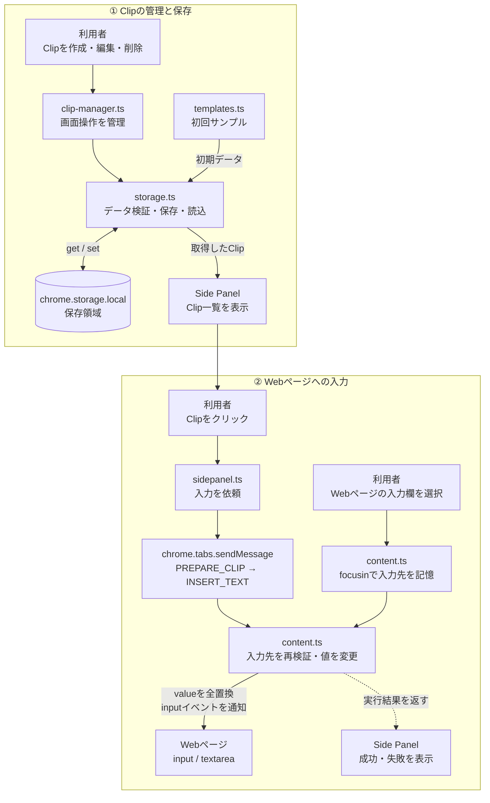
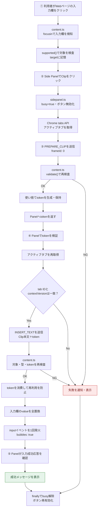
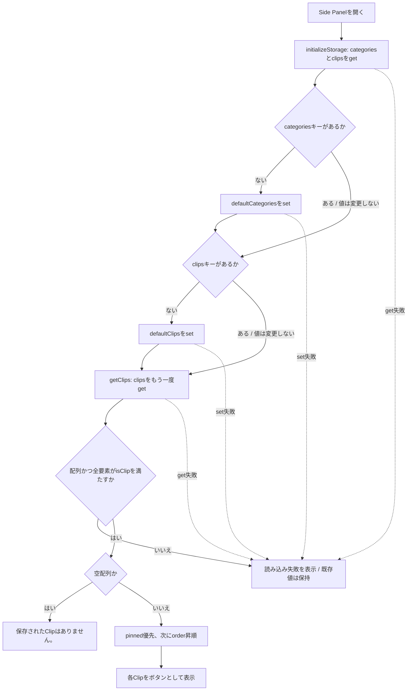
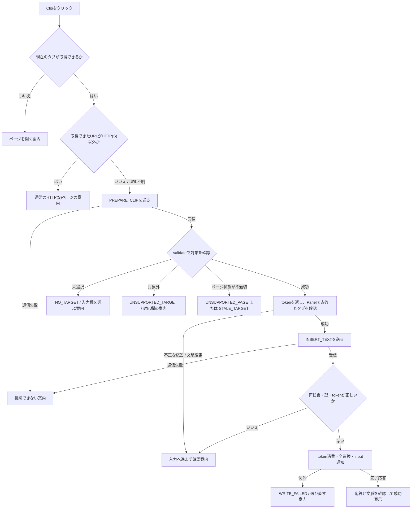

# LG Quick Clip のデータの流れ

この文書は、現在のMVPを読み、次にどのファイルを触るか判断するための地図です。**Side PanelはClipを選んで依頼する場所、content scriptはページの入力欄を書き換える場所、storageはClipを保存・読み込みする場所**と覚えると、処理を追いやすくなります。

対象ソースは、2026-10-13に確認したmainの [`8266853b934443b9993cf22fb1156985608c898f`](https://github.com/Leon20200809/lg-quick-clip/tree/8266853b934443b9993cf22fb1156985608c898f) です。以下の相対リンクの行番号も、この版に対応します。将来コードが変わった場合は、上記の固定版と比較してください。

これは実装済みの流れの説明です。Clipの追加・編集・削除UI、カテゴリUI、同期、Issue #2の新機能は含みません。

## 最初に読む順番

1. [全体像](#全体像)で、画面・通信・入力欄・保存先の位置関係を見る。
2. [Clipを押したときの順番](#clipを押したときの順番)を見ながら、`sidepanel.ts` → `content.ts` の順で読む。
3. 初期値や一覧を変えたい場合は[保存データを読む順番](#保存データを読む順番)へ進む。
4. 動かない場合は[失敗を検知する場所と画面表示](#失敗を検知する場所と画面表示)で、調べるファイルを絞る。
5. 編集前に[変更したいことからファイルを探す](#変更したいことからファイルを探す)と[検証の範囲](#検証の範囲)を確認する。

## 全体像

- **画面の担当**：[`sidepanel.ts`](../src/sidepanel/sidepanel.ts#L140-L166) が保存Clipをボタンにし、クリック時に `clip.text` を送ります。ラベルや状態表示には `textContent` を使い、文字列をHTMLとして実行させません。
- **ページの担当**：[`content.ts`](../src/content/content.ts#L1-L155) が入力先を記憶し、要求を受けた時点でも安全確認します。Side Panel自身はWebページの入力欄を直接操作しません。
- **保存の担当**：[`storage.ts`](../src/storage/storage.ts#L1-L57) がChromeのローカル保存領域とやりとりします。Clipのクリック自体は保存データを変更しません。
- **起動の担当**：[`background.ts`](../src/background/background.ts) は拡張アイコンでSide Panelを開く設定をします。このMVPのClip本文を中継する役ではありません。[`manifest.json`](../public/manifest.json) はSide Panel、background、HTTP(S)ページで動くcontent scriptの入口を指定します。

Side Panel、ページ内の処理、保存領域は別の場所です。役割を分けることで、「見せ方を直す」「入力条件を直す」「保存値を調べる」の入口が分かります。これは現在ある責務の説明であり、新しい層やファイル分割を要求するものではありません。

## Clipを押したときの順番

以下は成功する場合の順番です。途中の検査に失敗した場合は入力へ進まず、後述の案内になります。

### なぜ入力先を記憶するのか

利用者がSide Panelを操作すると、ページの入力欄から操作場所が移ります。そのため、入力するときだけフォーカスを探すのではなく、ページで選ばれた欄の参照を `target` に保持します。保存領域へ記録するのではなく、そのページで動くcontent script内の一時的な変数です。

[`focusin` の処理](../src/content/content.ts#L45-L54)は、対応する欄なら `target` を更新し、対象外なら以前の欄も解除します。disabled欄などへの操作は [`pointerdown`](../src/content/content.ts#L55-L73)、iframeへの移動は [`blur`](../src/content/content.ts#L74-L80)でも補い、ページから離れる `pagehide` では対象と予約を破棄します。対象外へ移った後、前の欄に勝手に戻って入力する設計ではありません。

対応するのは、HTTP(S)のトップフレームにある通常の `input` の `text`・`email`・`tel` と `textarea` です。type省略は通常 `text` になります。[`supported`](../src/content/content.ts#L14-L36) はreadonly、実効disabled、切断された要素、別文書、Shadow DOM、認証用途を明示したautocompleteも拒否します。password、number、search、url、contenteditable等は対象外です。React等の制御入力は対応範囲に含めません。Reactを識別する専用判定があるという意味ではありません。

### なぜ通信を二段階にするのか

[`PREPARE_CLIP`](../src/content/content.ts#L118-L129) は「この文書の、この選択に入力してよいか」の事前確認です。この段階ではClip本文を送りません。受信側は `validate()` が成功するとランダムなtokenを発行します。

[`INSERT_TEXT`](../src/content/content.ts#L131-L151) は本文を渡して実際に入力する要求です。受信側はもう一度ページと対象を検査し、本文とtokenの型、保持中のtokenとの一致を確認します。tokenは書込み前に `null` にするため、同じ予約を再送しても再実行できません。新たなフォーカス移動や対象の解除でも失効します。文書が変われば以前のcontent scriptの予約は引き継がれません。

Side Panelも、予約の応答を待つ間にタブが変わる可能性に備えて、[アクティブタブと `contextVersion` を再確認](../src/sidepanel/sidepanel.ts#L73-L116)します。これらは誤入力を減らすための複数の確認です。ブラウザAPIをまたぐ全処理を一つの不可分な操作にするものではなく、競合を完全に排除する保証ではありません。

### 成功表示は何を意味するのか

[`target.value = request.text`](../src/content/content.ts#L142-L151) は、現在値の末尾に足したり選択範囲だけを置き換えたりせず、**欄の値全体を置き換えます**。続いて `input` イベントを1回通知し、受信側が `{ ok: true, inserted: true }` を返します。

Side Panelは、予約の成功だけでなく、この[入力完了応答](../src/sidepanel/sidepanel.ts#L113-L116)があり、操作中に文脈が変わっていない場合だけ成功表示します。これは拡張側の書込み処理が例外なく終わったという応答です。ページ側の保存、サーバーへの送信、後から値が戻されないことまで保証するものではありません。

拡張自身はsubmit、Enter、送信ボタンのクリックを行いません。ただしページ側が `input` に反応して送信する場合は防げません。実データや秘密情報を使わず、専用のテストページで確認してください。

## 保存データを読む順番

Side Panelの起動時に、[`initializeStorage()` → `getClips()`](../src/sidepanel/sidepanel.ts#L140-L166) の順で呼びます。初期化と読込みを分ける理由は、既存値を勝手にサンプルへ戻さず、保存データの問題を利用者へ知らせるためです。

### 未作成と空は違う

[`Object.hasOwn`](../src/storage/storage.ts#L12-L30) で調べるのは「キーがあるか」です。値が空か、正しそうか、真になる値かではありません。

| 保存状態                     | 初期化時                   | 読込み後の表示                            |
| ---------------------------- | -------------------------- | ----------------------------------------- |
| `clips` キーなし             | `defaultClips` を保存      | 例示Clipの一覧                            |
| `clips: []`                  | 空配列を保持               | 「保存されたClipはありません。」          |
| 正しい形式のClip配列         | そのまま保持               | pinned優先、order昇順で表示               |
| `clips: null` などの不正形式 | そのまま保持               | 読み込み失敗の案内                        |
| `categories` キーなし        | `defaultCategories` を保存 | 現MVPはカテゴリUIを描画しない             |
| `categories` が既存          | 空・不正な値も保持         | `getClips` はcategoriesの形式を検査しない |

[`isClip`](../src/storage/storage.ts#L44-L57) が検査する項目は、`id`・`categoryId`・`label`・`text` が文字列、`pinned` がboolean、`order` が有限の数値であることです。IDの重複やカテゴリとの対応まで検査するものではありません。

初期化の2つの `set` は順番に実行され、一括のトランザクションではありません。たとえばcategoriesの初期保存に成功してからclipsの保存に失敗した場合、前者は残り得ます。「既存値を上書きしない」と「失敗時にすべてを元へ戻す」は別です。[`templates.ts`](../src/data/templates.ts) を変更しても、すでにあるキーには反映されません。既存データを消して反映させる運用は、この文書では推奨しません。

## 失敗を検知する場所と画面表示

図は入力操作の主な分岐です。表示する正確な文言、応答欠落、保存読込みの失敗は下表を参照してください。文脈が変わった場合は新しいタブ変更案内を維持し、古い処理の表示は抑えます。

通信の失敗コードは [`message.ts`](../src/types/message.ts) に定義し、Side Panelの [`errors`](../src/sidepanel/sidepanel.ts#L9-L19) が日本語に変換します。すべての失敗がコードとして返るわけではありません。受信側がいない場合やstorageの例外は、呼出元の `catch` で案内します。

| 状況                                                                           | 検知する場所                                                | コード・扱い                                                            | Side Panelの表示                                                                                                                             |
| ------------------------------------------------------------------------------ | ----------------------------------------------------------- | ----------------------------------------------------------------------- | -------------------------------------------------------------------------------------------------------------------------------------------- |
| ページを開いた後、入力欄をまだ選んでいない                                     | contentの `target` 初期値と `validate()`                    | `NO_TARGET`                                                             | 「ページ上の入力欄を選んでからClipを押してください。」                                                                                       |
| 対象外の欄へ移動、readonly化・削除など                                         | contentの `supported()`、選択イベント、`validate()`         | `UNSUPPORTED_TARGET`                                                    | 「この入力欄は対象外です。通常のtext・email・tel欄またはtextareaを選んでください。」                                                         |
| HTTP(S)以外、トップフレーム以外                                                | PanelのURL検査、contentの `validate()`                      | `UNSUPPORTED_PAGE`。URLを取得できず通信できない場合は接続失敗の共通案内 | 「通常のHTTP(S)ページで利用してください。」                                                                                                  |
| タブ・ページ・選択が変わった、非表示、token不一致や再利用                      | Panelの再取得と世代確認、contentの `validate()` とtoken照合 | `STALE_TARGET`                                                          | 「タブ・ページ・入力欄が変わりました。入力欄を選び直してください。」                                                                         |
| 受信した本文やtokenの型が不正、段階に必要な応答がない                          | contentの型検査、Panelの段階別確認                          | `INVALID_MESSAGE`                                                       | 「通信内容を確認できませんでした。拡張とページを再読み込みしてください。」                                                                   |
| 応答が欠落、不明な形式・失敗コード                                             | Panelの `response()`                                        | 専用コードを返すのではなく例外                                          | 「入力結果を確認できませんでした。拡張とページを再読み込みしてください。」                                                                   |
| 書込み・イベント通知処理で例外                                                 | contentの入力処理の `catch`                                 | `WRITE_FAILED`、対象とtokenを破棄                                       | 「入力できませんでした。入力欄を選び直してください。」                                                                                       |
| content scriptがいない、拡張更新後の古いページ、制限ページ、未知の通信失敗など | Panelの `sendClipText()` の `catch`                         | 接続失敗を共通の復旧案内にまとめる                                      | 「このページには接続できません。HTTP(S)ページを再読み込みし、入力欄を選び直してください。Chrome内部ページ・Web Store等では利用できません。」 |
| 現在のタブIDが取得できない                                                     | Panelの最初の `tabs.query()` 後                             | 例外                                                                    | 「現在のタブが見つかりません。ページを開いてください。」                                                                                     |
| storageのget/set失敗、不正なClip                                               | storageからの例外をPanelの起動時 `catch` が受ける           | 読み込み失敗。空一覧の成功扱いにしない                                  | 「Clipを読み込めませんでした。保存データまたはストレージ接続を確認し、Side Panelを開き直してください。既存のClipは変更していません。」       |

検知箇所：[`content.ts` の対象・ページ検査](../src/content/content.ts#L14-L96)、[受信・入力処理](../src/content/content.ts#L98-L155)、[`sidepanel.ts` の応答処理](../src/sidepanel/sidepanel.ts#L38-L60)、[送信と失敗表示](../src/sidepanel/sidepanel.ts#L62-L138)、[storage失敗表示](../src/sidepanel/sidepanel.ts#L140-L166)。

注意点は次の通りです。

- タブ変更やタブのloadingを検知すると、先に「タブ・ページが変わりました。入力欄を確認してからClipを押してください。」と表示します。古い操作の結果でその案内を上書きしません。そのため上表の `STALE_TARGET` 文言が常に表示されるわけではありません。
- 接続失敗の文言だけでは、制限ページなのか、受信側の不在なのか、別の通信問題なのかを確定できません。成功扱いせず、通常ページの再読み込みと選び直しを案内します。
- `WRITE_FAILED` はロールバック完了を意味しません。値を代入した後の処理で例外になれば、一部の副作用が残り得ます。別の欄へ代替入力したり自動再送したりはしません。
- 送信元IDが自分の拡張と違う場合や、未知の要求typeはcontent側で無視します。すべてに `INVALID_MESSAGE` を返すわけではありません。

## ファイルごとの役割

「入力」はそのファイルが受け取る情報、「出力」は返す情報や作る結果、「副作用」は画面・保存領域など外側に起きる変化です。

| ファイル                                                                                                  | 日本語一文での役割                                     | 入力                                   | 出力                                                        | 主な副作用                                              |
| --------------------------------------------------------------------------------------------------------- | ------------------------------------------------------ | -------------------------------------- | ----------------------------------------------------------- | ------------------------------------------------------- |
| [`src/sidepanel/sidepanel.ts`](../src/sidepanel/sidepanel.ts)                                             | Clip操作を取りまとめ、結果を利用者へ伝える。           | 保存Clip、クリック、タブ情報、受信応答 | 2種類の入力要求、日本語の状態表示                           | ボタン生成・無効化、状態欄更新、タブ照会・通信          |
| [`src/content/content.ts`](../src/content/content.ts)                                                     | ページで選んだ入力欄へ、安全確認後にClipを入力する。   | focusin等のイベント、要求と送信元      | token、入力完了、失敗コード                                 | 対象とtokenの一時保持、欄の全置換、inputイベント通知    |
| [`src/storage/storage.ts`](../src/storage/storage.ts)                                                     | 既存値を守りながら初期化とClip読込みの境界を管理する。 | Chrome保存値、初期例示データ           | 検証済み `Clip[]`、または例外                               | 未作成キーだけ `storage.local.set`                      |
| [`src/types/message.ts`](../src/types/message.ts)                                                         | 要求と応答の共通の形を定義する。                       | TypeScriptの型定義                     | `QuickClipMessage`、`QuickClipResponse`、`QuickClipFailure` | 実行時の通信・検証・保存は行わない                      |
| [`src/types/template.ts`](../src/types/template.ts)                                                       | CategoryとClipの項目の型を定義する。                   | TypeScriptの型定義                     | `Category`、`Clip`                                          | 実行時のデータ検証は行わない                            |
| [`src/data/templates.ts`](../src/data/templates.ts)                                                       | 初回用の例示カテゴリとClipを用意する。                 | コードに記載したサンプル値             | `defaultCategories`、`defaultClips`                         | このファイル自身は保存しない                            |
| [`src/background/background.ts`](../src/background/background.ts)                                         | 拡張アイコンでSide Panelが開くよう設定する。           | 拡張の起動                             | Side Panelの動作設定                                        | `setPanelBehavior`、失敗時のconsole.error               |
| [`public/manifest.json`](../public/manifest.json)                                                         | Chromeへ拡張の入口と権限を宣言する。                   | 拡張の設定                             | `storage`・`sidePanel`権限、各入口、HTTP(S)対象             | Chromeが各スクリプトを読み込む条件を決める              |
| [`src/sidepanel/sidepanel.html`](../src/sidepanel/sidepanel.html) / [CSS](../src/sidepanel/sidepanel.css) | Side Panelの表示枠と見た目を用意する。                 | HTML要素・CSSルール                    | `#clip-list`、`#status`、スタイル                           | 状態欄は `role="status"` と `aria-live="polite"` で通知 |

処理と失敗時の責任も、同じファイルに結びつけて読めます。

| ファイル               | 主な処理                                                                      | 失敗時の責任                                                              |
| ---------------------- | ----------------------------------------------------------------------------- | ------------------------------------------------------------------------- |
| `sidepanel.ts`         | 初期化→検証済みClipの並び替え→描画。クリック時は予約→再確認→入力要求→応答確認 | 既知コードを説明に変換し、通信・保存の例外も表示。finallyで操作状態を解除 |
| `content.ts`           | 選択の記憶→対象検査→予約発行→token照合→全置換                                 | 検査失敗をコードで返す。書込み例外時は対象を解除。未知の要求等は無視      |
| `storage.ts`           | キーの有無で初期化を判断し、読んだclipsを `isClip` で検査                     | 例外を呼出元へ伝える。不正値をサンプルで修復しない                        |
| `types/message.ts`     | 要求・応答・失敗コードの型を定義                                              | 実行時のエラー処理はせず、受信側・送信側の処理が担当                      |
| `types/template.ts`    | CategoryとClipの項目の型を定義                                                | 実データの検証はstorageが担当                                             |
| `data/templates.ts`    | 例示値を配列としてexport                                                      | 独自の失敗処理なし。保存の成否はstorageが担当                             |
| `background.ts`        | `setPanelBehavior` を呼び出す                                                 | 設定失敗をconsole.errorへ出す。Panelの状態欄には表示しない                |
| `manifest.json`        | Chromeが読み込む設定を宣言                                                    | 独自のエラー処理なし。設定の検証はビルド・テスト・Chrome読み込みで確認    |
| `sidepanel.html` / CSS | 表示枠とスタイルを定義し、Panelのスクリプトを読み込む                         | 独自のエラー処理なし。Clipの操作結果は `sidepanel.ts` が状態欄へ表示      |

型定義は「開発時の約束」です。保存領域や通信から実際に届いた値が正しいとは限らないため、実行時にも `isClip()`、`response()`、content側の検査を行います。

## 用語をコードと結びつける

- **Side Panel**：Chromeの横に開く拡張の画面です。ここでは保存Clipの選択と結果表示を担当します。例は `sidepanel.html` の `#clip-list` と `#status` です。
- **DOM（Document Object Model）**：ページの要素をプログラムから扱うための構造です。ここでは入力欄の実体を `target` に保持し、`target.value` を変更します。画面上の文字列やCSSセレクターだけを覚えているわけではありません。
- **chrome.storage.local**：Chrome拡張用のローカル保存APIです。ここでは `clips` と `categories` をキーにして初期値や保存済みデータを扱います。例は `chrome.storage.local.get("clips")` で、Webページの `localStorage` とは別です。
- **content script**：Webページ側で動く、拡張が読み込ませたスクリプトです。このプロジェクトでは `content.ts` が担当し、そのページの入力欄を扱います。
- **runtime message**：拡張の別の実行場所へ要求や応答を渡す仕組みです。ここではSide Panelが `chrome.tabs.sendMessage` で指定タブへ送り、content scriptが `chrome.runtime.onMessage` で受け取ります。`chrome.runtime.sendMessage` を使っているという意味ではありません。
- **トップフレーム**：タブのいちばん外側のページです。埋め込まれたiframeと区別します。送信の `frameId: 0` と受信の `window === window.top` が対応します。
- **token**：この操作では「直前の予約と同じ文書・選択か」を照合する一度限りの文字列です。ログイン用の認証情報ではなく、入力要求を結びつけるために一時保持します。保存領域には書きません。
- **バリデーション**：処理する前に、値の型や対象の状態が条件を満たすか確認することです。`validate()` や `isClip()` に現れます。
- **bubbling**：要素で発生したイベントが親要素側へ伝わる仕組みです。`new Event("input", { bubbles: true })` により、親側でinputを監視するページにも変更を通知できます。ユーザーの実際のキー入力を再現するものではありません。
- **ack / 応答**：受信側から返す処理結果です。ここでは `inserted: true` が入力処理の完了通知で、予約時の `token` 応答とは区別します。
- **副作用**：値を返すだけでなく、入力欄を書き換える、ボタンを表示する、保存領域へ書くといった外側の変化です。

## 変更したいことからファイルを探す

| 変更したいこと                     | 最初に読む場所                                | 一緒に確認すること                                                     |
| ---------------------------------- | --------------------------------------------- | ---------------------------------------------------------------------- |
| 状態メッセージやClipボタンの見せ方 | `sidepanel.ts`、HTML、CSS                     | 成功は入力完了応答後だけ表示すること。文字列をHTMLとして扱わないこと   |
| 対応入力欄・対象外条件             | `content.ts` の `supported()` と `validate()` | 選択時と送信時の両方の検査、古い対象を解除する処理、回帰テスト         |
| 通信の項目や失敗コード             | `types/message.ts`                            | 送信側・受信側・応答検査・表示・テストを同じ契約にそろえること         |
| 初回の例示Clip                     | `data/templates.ts`                           | 既存キーは変更されないこと。秘密情報を書かないこと                     |
| 保存形式や読込み条件               | `types/template.ts` と `storage/storage.ts`   | 既存・空・不正データを保持すること。移行や編集UIは別途設計が必要なこと |
| 拡張の入口や実行対象               | `public/manifest.json` と `background.ts`     | 権限とHTTP(S)対象。安易に権限を増やさないこと                          |

手で追うときは、まず [`sidepanel.ts` の起動部分](../src/sidepanel/sidepanel.ts#L140-L166)、次に [`sendClipText()`](../src/sidepanel/sidepanel.ts#L62-L138)、最後に [`content.ts` の受信処理](../src/content/content.ts#L98-L155) の順で読むと、一つのClipがどこを通るかつながります。生成物の `dist` を直接編集せず、元の `src` や `public` を編集してビルドします。

## 検証の範囲

本文の説明は、冒頭に固定したソースの分岐・型・副作用に基づきます。図は処理を理解するためのもので、Chrome実機の動作確認を代わりに証明するものではありません。

mainの[統合コミット](https://github.com/Leon20200809/lg-quick-clip/commit/8266853b934443b9993cf22fb1156985608c898f)には、オーナーによる「登録済み項目から貼り付け成功」「この入力欄は対象外メッセージも確認」の2点が記録されています。これをすべての入力型、タブ切替、通信失敗、ストレージ失敗等の受入完了へ広げて解釈しません。

- 自動検証は [`tests/mvp.test.mjs`](../tests/mvp.test.mjs) を参照してください。NodeのDOM・Chrome APIテストダブルによる確認で、実ブラウザの動作とは区別します。
- Chromeでの確認方法は [README](../README.md) と [`tests/manual.html`](../tests/manual.html) を参照してください。READMEの未実行記録は当時の記録として読み、実行していない項目を完了扱いしないでください。
- 学習用の変更でも、`npm run typecheck`、`npm test`、`npm run build`、`npm run format:check` と差分確認を行います。入力や通信の挙動を変えた場合は、専用Chromeプロファイルとサンプル値で該当する受入項目も確認します。
- 通常のtext欄が秘密情報用かを完全に判別することはできません。Clipにパスワードや認証コードを保存・入力しないでください。
